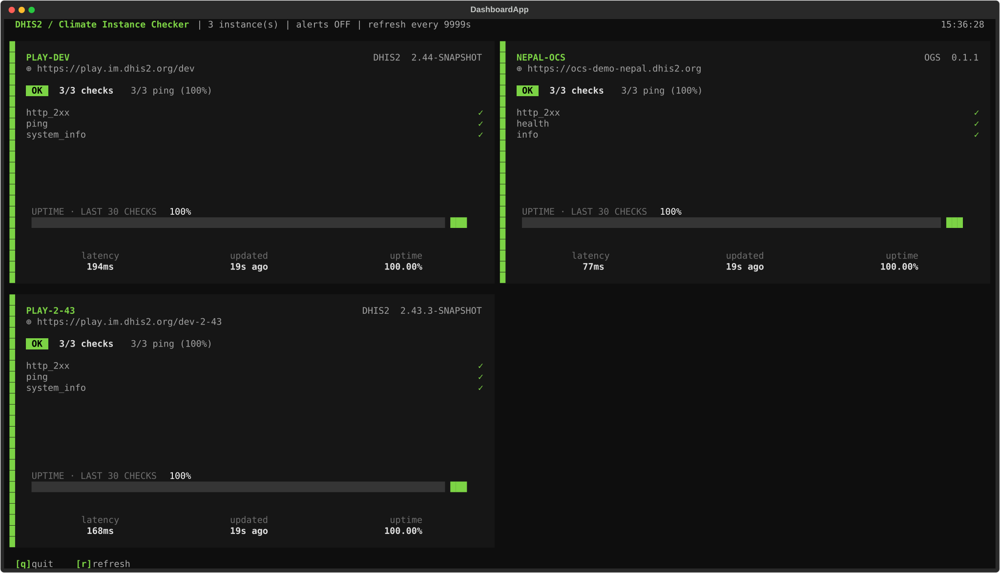
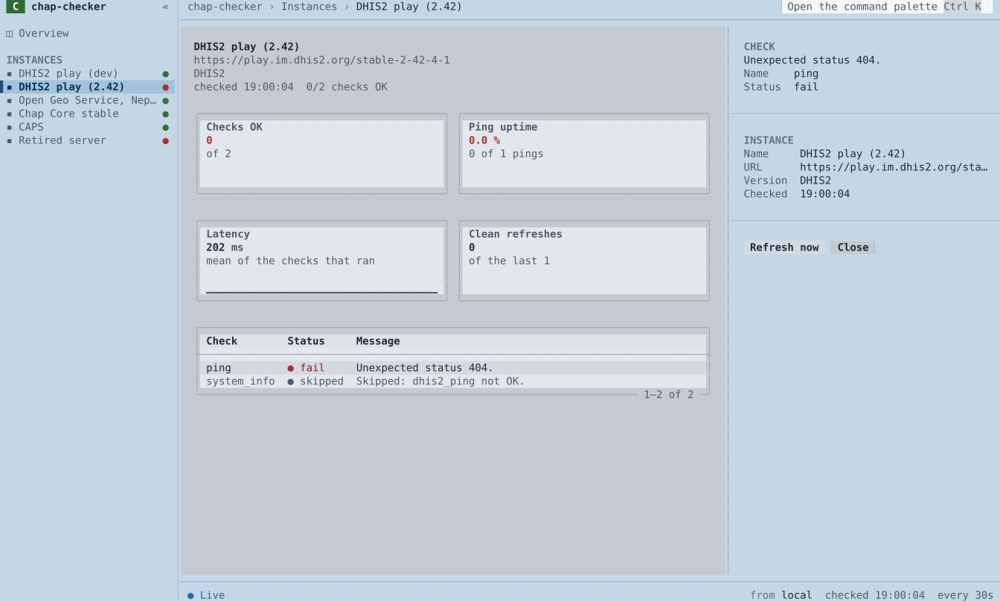
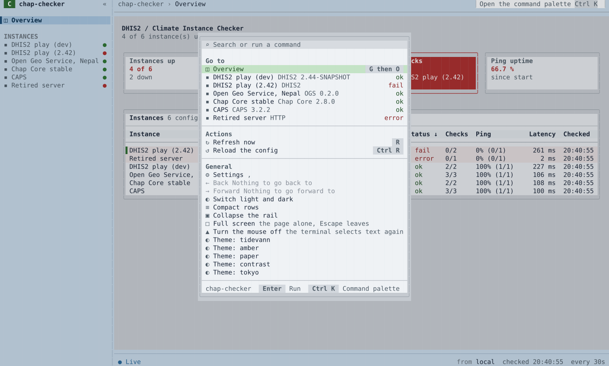
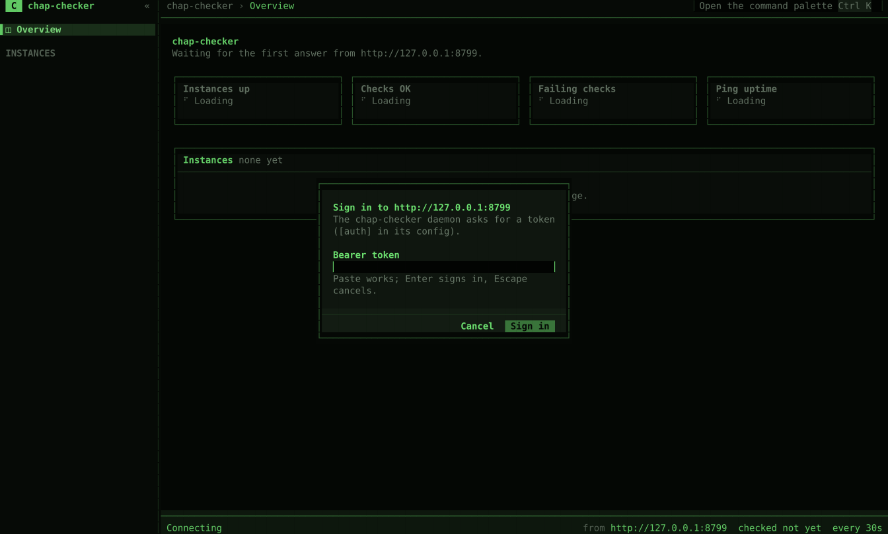

# TUI dashboard

```bash
chap-checker tui
```

A terminal dashboard of every configured instance, drawn with
[sokkel-tui](https://github.com/winterop-com/sokkel-tui): a rail of instances
with their status, an overview, and a page per instance. Leave it on a
second monitor, or run it full screen on a wall display with `--kiosk`.



The `dhis2` theme (sokkel's `tray`: a grey tray with white panels) for a DHIS2
ops environment:


## Layout

- **Rail** (left): *Overview*, then every instance with a dot in its worst
  status's colour (ok, warn, fail, error). The rail is as wide as the longest
  name, up to 45 columns; a longer name is cut in the middle, keeping its
  start and its end, and shows in full in the status line while its entry
  has focus. Drag the rail's edge to resize it (kept
  across runs; Enter on the edge puts it back). When the window is too
  narrow for both the rail and the tables, the rail narrows and then folds
  to its icons, so the tables stay tables. Below 90 columns the rail becomes
  a drawer; `«` collapses it to icons.
- **Overview**:
    - four summary tiles: instances up (`9 of 10`, with a note on how many
      are down or have warnings; an instance with only a warning counts as up
      but turns the tile amber), checks OK (`38 of 40`), failing checks
      (filled red when there are any, naming the first: `ping on DHIS2 play`),
      and ping uptime;
    - the instances table: name, platform and version (`DHIS2 2.42.6`,
      `Chap Core 2.7.0`, `CAPS 3.2.2`), status, checks OK, ping uptime,
      latency and the last check. Failing instances come first, then those
      with warnings, then the rest in config order; a row is tinted when its
      instance is failing. Instance, Status and Latency sort from their
      headings.
      Up and Down move through it, Enter or a click opens the instance.
- **Instance page**: its URL and version, tiles for checks OK, ping uptime,
  latency (with a sparkline of the last refreshes) and clean refreshes, then
  every check with its message. Up and Down move through the checks; Enter or
  a click opens one in a side panel: its full message and status, the
  instance's URL, version and when it was checked, and *Refresh now*. Below
  90 columns the panel covers the page. Escape closes the panel, then goes
  back.
- **Status line** (bottom): *Live*, *Refreshing*, *Disconnected* or
  *Signed out*, where the data comes from (`local` or the daemon's URL), when
  it was last checked, and the interval.


A failing check opened in the side panel:



## Keys

| Key        | Action                                                           |
| ---------- | ---------------------------------------------------------------- |
| `r`        | Refresh now (otherwise every `--interval` seconds).              |
| `g` `o`    | Go to the overview.                                              |
| `Ctrl+R`   | Reload `chap-checker.toml` from disk (on the daemon in connect mode). |
| `Ctrl+K`   | The command palette.                                             |
| `,`        | Settings: the theme, light or dark, density, the frame.          |
| `?`        | Every key.                                                       |
| `/`        | Search.                                                          |
| `Tab`      | Move through the rail, the page's table and the side panel's buttons (Enter presses one). |
| `Escape`   | Close what's open, then go back a page; leave full screen.       |
| `Left`     | Back a page (while no control on the page has focus).           |
| `Right`    | Forward again, after going back.                                 |
| `Ctrl+Q`   | Quit.                                                            |

A reload's outcome shows in a banner for a few seconds: the instances added
and removed, or why it failed (a TOML error, an unset `password_env`). A
failed reload leaves the previous config running.

## Command palette

`Ctrl+K` lists chap-checker's commands before the frame's own:



- **Go to**: the *Overview* (`g` then `o`) and every instance, each with its
  platform and version and its status in its colour.
- **Actions**: *Refresh now* (`r`), *Reload the config* (`Ctrl+R`), and in
  connect mode *Sign in*.
- The frame's: *Back* and *Forward*, the theme, full screen, the rail, the
  settings.

The palette is as wide as its longest command, up to 60% of the window; a
row still cut short shows in full in its footer while it is active.

Type to filter. What you type also searches every instance's checks, by name
and by message (`404`, `timeout`, `system_info`): the matches show under
*Checks*, and choosing one opens its instance with the check in the side
panel.

## Alerts decision is at launch

```bash
chap-checker tui               # alerts OFF (the "TUI is enough" default)
chap-checker tui --alerts      # also dispatch Slack on transitions
```

When `--alerts` is set, the same per-instance `alerts = [...]` opt-in from the
TOML applies; instances without an opt-in stay silent. There is no runtime
toggle: keeping it explicit at launch matches the `verify --no-alerts`
semantics.

## Tweaking the refresh cadence

```bash
chap-checker tui --interval 10         # tick every 10s
chap-checker tui --interval 120        # tick every 2 minutes
```

`--interval` accepts `>= 2.0`.

## Wall display

```bash
chap-checker tui --kiosk
chap-checker tui --kiosk --connect http://tv-host:8765
```

`--kiosk` starts full screen: no rail and no top bar, the page fills the
window above the status line. At 122 columns and wider the page uses the full
width. Escape (or *Full screen* in the palette) leaves it.

## Colours

The TUI picks the terminal's colour depth itself: truecolor when `COLORTERM`
says so, 256 colours otherwise, 16 on terminals known to have only 16
(`TERM=linux`, `vt100`). Force one with `SOKKEL_COLORS=truecolor`, `256`, `16`
or `none`.

## Connect mode (cross-machine consistency)

```bash
# On the TV machine (the daemon: runs the checks, fires alerts):
chap-checker serve --host 0.0.0.0 --alerts

# On the laptop (thin client: just renders, no checks):
chap-checker tui --connect http://tv-host:8765
```

In `--connect` mode the TUI does not load a config or run any checks itself.
It polls `{URL}/api/state` every interval and shows what the daemon reports,
in the daemon's `[ui] theme`. If the daemon goes down, a banner says so under
the top bar, the status line reads *Disconnected*, and the last data stays on
screen marked stale (`since 12:04`); the next answer clears it. The TUI works
against any `chap-checker serve`.

Pressing `r` (or *Refresh now*) asks the daemon to re-run every check
(`POST {URL}/api/refresh`) and then reads the fresh state; `Ctrl+R` asks it to
reload its config (`POST {URL}/api/reload`).

`--connect` is mutually exclusive with `--config`, `--state`, and
`--alerts` (those settings live on the remote daemon).

### Auth prompt

If the daemon requires a bearer token (`[auth]` configured) and you didn't
pass `--token` / `--token-env`, the first 401 opens a prompt over the
dashboard:



The field is masked and paste works; *Sign in* stays off while it is empty.
Enter (or *Sign in*) sends the token, and the prompt waits with *Submitting*
while the daemon checks it. A token the daemon accepts closes the prompt; one
it turns down keeps the prompt open, with "Not accepted: check the token." in
it and the token still there to correct. The prompt follows the daemon's
theme:


Escape (or *Cancel*) closes it and shows the "auth rejected" banner instead,
and stops prompting; *Sign in* in the palette opens it again.

## How the TUI relates to `verify` and `serve`

All three share one runner, one snapshot of the instances, and the same
per-instance `checks` filter and `alerts` opt-in. In local mode the TUI and
`serve` each run their own check loop; in `--connect` mode the TUI is a thin
client of the `serve` daemon's. Cron `verify` is independent of both; if you
want a single authoritative alert path, stop running cron and let
`chap-checker serve --alerts` fire instead.

## Regenerating the screenshots

The images on this page are checked in under `docs/assets/`. To re-capture
them all, in both themes, against a config:

```bash
make docs-screenshot                       # uses ./chap-checker.toml
scripts/capture_docs_tui.sh path/to.toml   # or name one
```

The script draws each frame with the hidden `tui --frame COLSxROWS` flag (no
terminal needed) and starts a throwaway `serve` with `[auth]` for the token
prompt; alerts never fire. For one-off captures,
`scripts/capture_tui_rs.sh OUT [COLSxROWS] [tui args...]` writes an SVG, a
text dump and a PNG.
