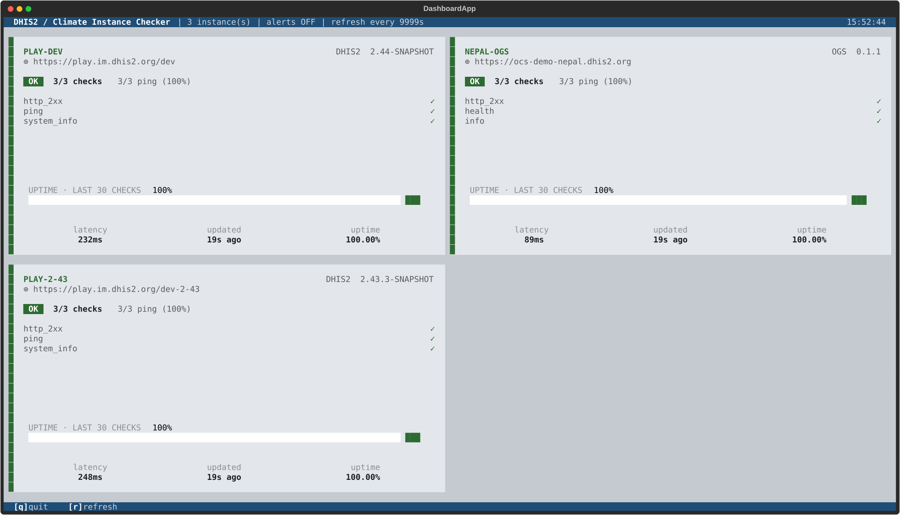
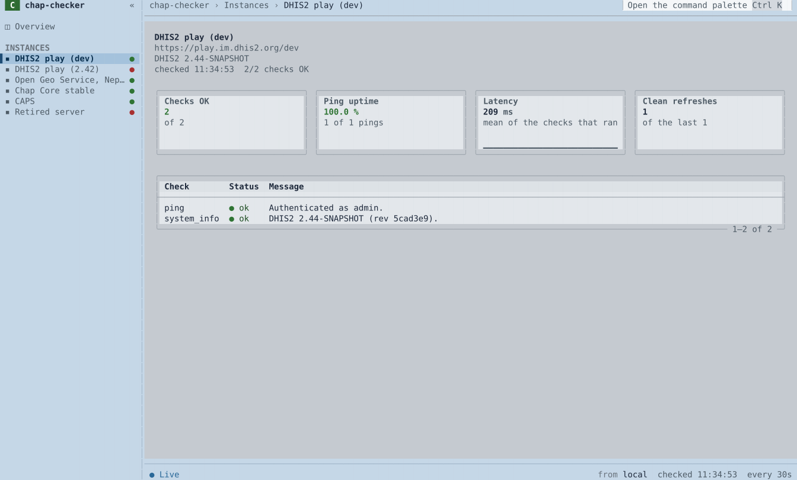
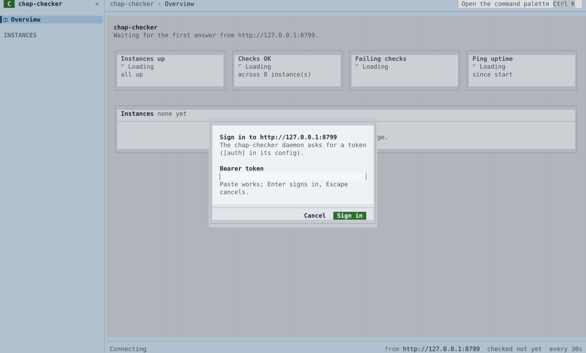

# TUI dashboard

```bash
chap-checker tui
```

A terminal dashboard of every configured instance, drawn with
[sokkel-tui](https://github.com/winterop-com/sokkel-tui): a rail of instances
with their status, an overview, and a page per instance. Leave it on a
second monitor, or run it full screen on a wall display with `--kiosk`.


The `dhis2` theme (sokkel's `tray`: a grey tray with white panels) for a DHIS2
ops environment:



## Layout

- **Rail** (left): *Overview*, then every instance with a dot in its worst
  status's colour (ok, warn, fail, error). Below 90 columns the rail becomes a
  drawer; `«` collapses it to icons.
- **Overview**:
    - four summary tiles: instances up, checks OK, failing checks (filled red
      when there are any), and ping uptime;
    - the instances table: name, platform and version (`DHIS2 2.42.6`,
      `Chap Core 2.7.0`, `CAPS 3.2.2`), status, checks OK, ping uptime,
      latency and the last check. A row is tinted when its instance is failing.
      Up and Down move through it, Enter or a click opens the instance.
- **Instance page**: its URL and version, tiles for checks OK, ping uptime,
  latency (with a sparkline of the last refreshes) and clean refreshes, then
  every check with its full message. Escape goes back.
- **Status line** (bottom): *Live*, *Refreshing*, *Disconnected* or
  *Signed out*, where the data comes from (`local` or the daemon's URL), when
  it was last checked, and the interval.



## Keys

| Key        | Action                                                           |
| ---------- | ---------------------------------------------------------------- |
| `r`        | Refresh now (otherwise every `--interval` seconds).              |
| `Ctrl+R`   | Reload `chap-checker.toml` from disk (on the daemon in connect mode). |
| `Ctrl+K`   | The command palette.                                             |
| `,`        | Settings: the theme, light or dark, density, the frame.          |
| `?`        | Every key.                                                       |
| `/`        | Search.                                                          |
| `Tab`      | Move through the rail and the page.                              |
| `Escape`   | Close what's open, then go back a page; leave full screen.       |
| `Ctrl+Q`   | Quit.                                                            |

A reload's outcome shows in a banner for a few seconds: the instances added
and removed, or why it failed (a TOML error, an unset `password_env`). A
failed reload leaves the previous config running.

## Command palette

`Ctrl+K` lists chap-checker's commands before the frame's own:

- **Refresh now**, **Reload the config**, and in connect mode **Sign in**.
- **Open &lt;instance&gt;** for every instance.
- The frame's: the theme, full screen, the rail, the settings.

Type to filter.

## Alerts decision is at launch

```bash
chap-checker tui               # alerts OFF (the "TUI is enough" default)
chap-checker tui --alerts      # also dispatch Slack on transitions
```

When `--alerts` is set, the same per-instance `alerts = [...]` opt-in from the
TOML applies; instances without an opt-in stay silent. There is no runtime
toggle: keeping it explicit at launch matches the `verify --no-alerts`
semantics.

## Tweaking the refresh cadence

```bash
chap-checker tui --interval 10         # tick every 10s
chap-checker tui --interval 120        # tick every 2 minutes
```

`--interval` accepts `>= 2.0`.

## Wall display

```bash
chap-checker tui --kiosk
chap-checker tui --kiosk --connect http://tv-host:8765
```

`--kiosk` starts full screen: no rail and no top bar, the page fills the
window above the status line. At 122 columns and wider the page uses the full
width. Escape (or *Full screen* in the palette) leaves it.

## Colours

The TUI picks the terminal's colour depth itself: truecolor when `COLORTERM`
says so, 256 colours otherwise, 16 on terminals known to have only 16
(`TERM=linux`, `vt100`). Force one with `SOKKEL_COLORS=truecolor`, `256`, `16`
or `none`.

## Connect mode (cross-machine consistency)

```bash
# On the TV machine (the daemon: runs the checks, fires alerts):
chap-checker serve --host 0.0.0.0 --alerts

# On the laptop (thin client: just renders, no checks):
chap-checker tui --connect http://tv-host:8765
```

In `--connect` mode the TUI does not load a config or run any checks itself.
It polls `{URL}/api/state` every interval and shows what the daemon reports,
in the daemon's `[ui] theme`. If the daemon goes down, a banner says so under
the top bar, the status line reads *Disconnected*, and the last data stays on
screen marked stale (`since 12:04`); the next answer clears it. The TUI works
against any `chap-checker serve`.

Pressing `r` (or *Refresh now*) asks the daemon to re-run every check
(`POST {URL}/api/refresh`) and then reads the fresh state; `Ctrl+R` asks it to
reload its config (`POST {URL}/api/reload`).

`--connect` is mutually exclusive with `--config`, `--state`, and
`--alerts` (those settings live on the remote daemon).

### Auth prompt

If the daemon requires a bearer token (`[auth]` configured) and you didn't
pass `--token` / `--token-env`, the first 401 opens a prompt over the
dashboard:


The field is masked and paste works. Enter (or *Sign in*) reconnects with the
token. The prompt follows the daemon's theme:



Escape (or *Cancel*) shows the "auth rejected" banner instead and stops
prompting; *Sign in* in the palette opens it again. A token the daemon turns
down shows "auth rejected by URL: check the token value".

## How the TUI relates to `verify` and `serve`

All three share one runner, one snapshot of the instances, and the same
per-instance `checks` filter and `alerts` opt-in. In local mode the TUI and
`serve` each run their own check loop; in `--connect` mode the TUI is a thin
client of the `serve` daemon's. Cron `verify` is independent of both; if you
want a single authoritative alert path, stop running cron and let
`chap-checker serve --alerts` fire instead.

## Regenerating the screenshots

The images on this page are checked in under `docs/assets/`. To re-capture
them all, in both themes, against a config:

```bash
make docs-screenshot                       # uses ./chap-checker.toml
scripts/capture_docs_tui.sh path/to.toml   # or name one
```

The script draws each frame with the hidden `tui --frame COLSxROWS` flag (no
terminal needed) and starts a throwaway `serve` with `[auth]` for the token
prompt; alerts never fire. For one-off captures,
`scripts/capture_tui_rs.sh OUT [COLSxROWS] [tui args...]` writes an SVG, a
text dump and a PNG.
